<!-- ===========Profile Introduction========== -->
<p align="center">
  >>+Initializing+Kali+Profile...;>>>+Java+%7C+DSA+%7C+Web+Developer;>>>+Cybersecurity+Enthusiast;>>>+Keep+Building+%7C+Keep+Learning" />
</p>


<!--===============MERA SVG FILES -->




<!-- ================Main=========== -->

<!-- <div align="center"> -->


<!-- <a href="https://git.io/typing-svg">
  
</a> -->

<!-- ==================Visitors Count=============== -->

<!-- <div align="center">


</div> -->

<div align="center">


</div>

<!-- ================Portfolio & Quick Links================== -->
<div align="center">
  <h3>✨ Quick Links</h3>
  
  <a href="https://kali-prem.github.io/Portfolio/" target="_blank" rel="noopener noreferrer"></a>
  <a href="https://github.com/Kali-Prem/dsa-logic-building-playbook" target="_blank" rel="noopener noreferrer"></a>
  <a href="https://github.com/Kali-Prem/leetcode-company-wise-interview-questions" target="_blank" rel="noopener noreferrer"></a>
  <a href="https://www.linkedin.com/in/kali-prem" target="_blank" rel="noopener noreferrer"></a>
  <a href="https://leetcode.com/u/Prem_Kumar01" target="_blank" rel="noopener noreferrer"></a>
</div>

<!-- ===========GitHub Insights========== -->

## 

<p align="center">
  
</p>

<div align="center" style="margin: 12px 0 18px 0;">

<!-- <p align="center">
  
</p> -->

<p align="center">
  <table>
    <tr>
      <td>
        
      </td>
      <td width="30"></td>
      <td>
        
      </td>
    </tr>
  </table>
</p>

---

</div>

<!-- ===========LeetCode, HackerRank========== -->

<p align="center">
  
</p>

<div align="center" style="margin: 18px 0;">

<!-- <h2>📊 Coding Stats</h2> -->

<div style="
  display: flex;
  justify-content: center;
  gap: 20px;
  flex-wrap: wrap;
">

<!-- LeetCode -->
<div style="
  background-color: #0d1117;
  border: 1px solid #30363d;
  border-radius: 10px;
  padding: 15px;
  width: 400px;
">
  
</div>

</div>

</div>

<!-- ===========System Status========== -->

<p align="center">
  
</p>

<div align="center" style="margin: 18px 0 16px 0;">

### ⚡ Engineering Mindset & Core Bio

<blockquote style="display: inline-block; max-width: 680px; margin: 10px auto 14px auto; text-align: center;">
  💡 <i><b>"Simplicity is the soul of efficiency."</b></i> — Austin Freeman<br/>
  <sub>Bridging high-performance backend systems, algorithmic pattern mastery, and offensive cybersecurity.</sub>
</blockquote>

<p align="center" style="font-size: 15px; line-height: 1.6; max-width: 820px; margin: 6px auto 18px auto;">
  I am a software engineer driven by solving complex algorithmic bottlenecks and architecting hardened digital platforms. My craft bridges high-concurrency backend engineering, competitive DSA problem-solving, and offensive penetration testing.
</p>

</div>

<table width="100%">
  <tr>
    <td width="50%" valign="top">
      <h4>🎯 Backend Systems & Architecture</h4>
      Architecting high-performance microservices using <b>Java & Spring Boot</b>, optimizing concurrency models, and building resilient RESTful architectures.
    </td>
    <td width="50%" valign="top">
      <h4>🧠 Algorithmic Mastery (DSA)</h4>
      Active competitive solver and curator of pattern-based frameworks — turning complex problem constraints into clean, optimal O(1) and O(N) solutions.
    </td>
  </tr>
  <tr>
    <td width="50%" valign="top">
      <h4>🔐 Offensive Security & CTFs</h4>
      Hands-on penetration testing in Linux environments, network reconnaissance with Nmap, custom automation scripts in Bash & Python, and active CTF challenges.
    </td>
    <td width="50%" valign="top">
      <h4>🚀 Flagship Open-Source Platforms</h4>
      Creator of <a href="https://dsadoctor.com" target="_blank"><b>DSA Doctor</b></a> (company-wise interview questions platform) and author of the <a href="https://github.com/Kali-Prem/dsa-logic-building-playbook" target="_blank"><b>DSA Logic Building Playbook</b></a>.
    </td>
  </tr>
</table>

<table width="100%">
  <tr>
    <td align="center">
      <code>☕ Java & Spring Boot</code> &nbsp;•&nbsp; 
      <code>🧠 500+ Pattern DSA</code> &nbsp;•&nbsp; 
      <code>🔐 Offensive Linux / CTFs</code> &nbsp;•&nbsp; 
      <code>🚀 dsadoctor.com</code> &nbsp;•&nbsp; 
      <code>📘 Logic Playbook</code>
    </td>
  </tr>
</table>

<!-- ===========Tech Stack & Toolkit========== -->

<p align="center">
  
</p>

<div align="center" style="margin: 16px 0 24px 0;">

<h4>💻 Languages & Core Backend</h4>
<p align="center">
  
  
  
  
  
  
</p>

<h4>🌐 Web & Frameworks</h4>
<p align="center">
  
  
  
  
  
  
</p>

<h4>🔐 Cybersecurity & Pentesting</h4>
<p align="center">
  
  
  
  
  
</p>

<h4>🧰 Tools & Databases</h4>
<p align="center">
  
  
  
  
  
  
</p>

</div>

---

<!-- ===========Featured Project: DSA Doctor========== -->

##

<p align="center">
  
</p>

<div align="center" style="margin: 18px 0 24px 0;">

# 🩺 [DSA Doctor](https://dsadoctor.com) — [dsadoctor.com](https://dsadoctor.com)
### 🚀 The Ultimate Platform for Company-Wise DSA Coding Interview Questions

<p align="center">
  <a href="https://dsadoctor.com" target="_blank" rel="noopener noreferrer">
    
  </a>
  <a href="https://dsadoctor.com" target="_blank" rel="noopener noreferrer">
    
  </a>
  <a href="https://github.com/Kali-Prem/leetcode-company-wise-interview-questions" target="_blank" rel="noopener noreferrer">
    
  </a>
  <a href="https://github.com/Kali-Prem" target="_blank" rel="noopener noreferrer">
    
  </a>
</p>

<p align="center" style="margin-top: 10px;">
  <a href="https://dsadoctor.com" target="_blank" rel="noopener noreferrer">
    
  </a>
</p>

</div>

<div style="margin: 14px 0 20px 0;">

**[DSA Doctor](https://dsadoctor.com)** (live at **[dsadoctor.com](https://dsadoctor.com)**) is a comprehensive coding interview preparation platform engineered to help software developers, engineering students, and tech aspirants conquer **Data Structures & Algorithms (DSA)** through curated, **company-wise interview questions**.

Whether you search for **DSA Doctor**, **dsa doctor**, or **dsadoctor**, this platform serves as an all-in-one diagnostic and practice guide to ace technical interviews, coding assessments, and software engineering placements at top tech companies.

#### 🌟 Key Features of [DSA Doctor (dsadoctor.com)](https://dsadoctor.com):

- 🏢 **Company-Wise Question Banks**: Practice real-world coding problems asked by top-tier tech companies including **Google, Microsoft, Amazon, Meta, Apple, Netflix, Uber, Atlassian, Adobe**, and many more.
- 🎯 **Pattern-Based DSA Roadmaps**: Structured learning tracks covering core algorithmic patterns — Arrays, Two Pointers, Sliding Window, Dynamic Programming, Graphs, Trees, and Recursion.
- ⚡ **Interactive Real-Time Filters**: Effortlessly filter questions by company, difficulty level (**Easy, Medium, Hard**), core data structure topics, and appearance frequency.
- 🔗 **Direct LeetCode Integration**: Immediate access to verified LeetCode problem links with optimal time and space complexity guidelines.
- 🌙 **Modern Glassmorphic Dark UI**: High-performance, distraction-free interface with instant search and dark/light mode for daily coding sessions.

> 🌐 **Live Website**: [https://dsadoctor.com](https://dsadoctor.com)  
> 📂 **GitHub Repository**: [Kali-Prem/leetcode-company-wise-interview-questions](https://github.com/Kali-Prem/leetcode-company-wise-interview-questions)  
> 🏷️ **Search Tags**: `DSA Doctor` • `dsa doctor` • `dsadoctor.com` • `dsadoctor` • `company-wise DSA interview questions` • `LeetCode company-wise problems` • `coding interview preparation` • `DSA roadmap` • `Prem Kumar DSA Doctor`

</div>

<!-- ===========Featured Guide: DSA Logic Building Playbook========== -->
<p align="center">
  <a href="https://github.com/Kali-Prem/dsa-logic-building-playbook" target="_blank" rel="noopener noreferrer">
    
  </a>
</p>

<div align="center" style="margin: 18px 0 20px 0;">

# 📘 [DSA Logic Building Playbook](https://github.com/Kali-Prem/dsa-logic-building-playbook)
### 🧠 The Systematic Mental Model: Test Case Se Pattern Tak, Brute Force Se Optimal Tak

<p align="center" style="margin: 14px 0 10px 0;">
  <a href="https://github.com/Kali-Prem/dsa-logic-building-playbook" target="_blank" rel="noopener noreferrer">
    
  </a>
  <a href="https://youtu.be/G3lIEr2OTxk" target="_blank" rel="noopener noreferrer">
    
  </a>
</p>

</div>

<blockquote align="center" style="margin: 16px 0;">
  💡 <i><b>"Zyada log DSA me code nahi, logic me atakte hain."</b></i><br/>
  <sub>A battle-tested mental framework to develop problem-solving intuition from scratch without memorizing solutions.</sub>
</blockquote>

<div style="margin: 16px 0 24px 0;">

The **[DSA Logic Building Playbook](https://github.com/Kali-Prem/dsa-logic-building-playbook)** is a complete masterclass engineered to take you from reading an unseen problem statement to writing clean, optimal Java code:

<table width="100%">
  <tr>
    <td width="50%" valign="top">
      <h4>🪜 The 7-Step Blueprint</h4>
      A universal, end-to-end mental roadmap for dissecting any unseen coding problem from comprehension to bug-free code.
    </td>
    <td width="50%" valign="top">
      <h4>🧪 Test Case Pattern Derivation</h4>
      Techniques to dry-run manual test cases on paper to expose underlying algorithmic rules and mathematical invariants.
    </td>
  </tr>
  <tr>
    <td width="50%" valign="top">
      <h4>⚡ Brute Force to Optimal (O(N²) ➔ O(N))</h4>
      Systematic waste identification: pinpoint redundant computations and map them directly into optimal data structures.
    </td>
    <td width="50%" valign="top">
      <h4>⏱️ Constraint Decoding Matrix</h4>
      Reverse-engineer target time complexity directly from input size <code>N</code> before typing a single line of code.
    </td>
  </tr>
  <tr>
    <td width="50%" valign="top">
      <h4>🔑 Keyword-to-Pattern Cheat Sheet</h4>
      18 high-yield problem statement trigger keywords mapped instantly to core algorithmic paradigms.
    </td>
    <td width="50%" valign="top">
      <h4>☕ 8 Production Java Implementations</h4>
      Complete worked examples with line-by-line intuition, visual trace, edge cases, and clean Java code.
    </td>
  </tr>
</table>

<table width="100%">
  <tr>
    <td align="center">
      <a href="https://github.com/Kali-Prem/dsa-logic-building-playbook"><b>📂 Repository:</b> <code>Kali-Prem/dsa-logic-building-playbook</code></a>
      &nbsp;&nbsp;•&nbsp;&nbsp;
      <a href="https://youtu.be/G3lIEr2OTxk"><b>🎬 Video Walkthrough:</b> <code>Watch on YouTube</code></a>
      &nbsp;&nbsp;•&nbsp;&nbsp;
      <b>☕ Language:</b> <code>Java</code>
      <br/><br/>
      🏷️ <b>Topics:</b> <code>DSA Logic Building</code> • <code>Interview Preparation</code> • <code>Algorithmic Patterns</code> • <code>Mental Models</code> • <code>Java DSA</code>
    </td>
  </tr>
</table>

</div>

<!-- ===========Key Repositories========== -->

<p align="center">
  
</p>

<div style="margin: 10px 0 16px 0;">

### 🧠 Data Structures & Algorithms (DSA)

- 🌟 **[dsa-logic-building-playbook](https://github.com/Kali-Prem/dsa-logic-building-playbook)** (**⭐ Master Playbook**): The definitive mental framework teaching how to build logic in DSA problems. Learn how to derive patterns directly from test cases, eliminate brute force bottlenecks, decode constraints, and implement optimal solutions in clean Java. Includes 8 worked examples and video walkthrough!
- **[500-DSA-Pattern-Problems](https://github.com/Kali-Prem/500-DSA-Pattern-Problems)**: A curated and highly organized compilation of 500+ DSA pattern problems, designed to master problem-solving paradigms for top-tier coding interviews.
- **[Java-DSA-Learning](https://github.com/Kali-Prem/Java-DSA-Learning)**: Core Java implementations of fundamental data structures, custom algorithm optimizations, and step-by-step guides.
- **[leetcode-company-wise-interview-questions](https://github.com/Kali-Prem/leetcode-company-wise-interview-questions)** (Official Repository for **[DSA Doctor](https://dsadoctor.com)**): Targeted study lists and company-wise curated question sheets powering the live platform at **[dsadoctor.com](https://dsadoctor.com)**.

### 🔐 Cybersecurity & Pentesting

- **[Hacking-Learning](https://github.com/Kali-Prem/Hacking-Learning)**: Comprehensive reference sheets, ethical hacking labs, vulnerability assessment guides, and custom network security scripts.

### 🌐 Web & Full-Stack

- **[TeamUp-Ai](https://github.com/Kali-Prem/TeamUp-Ai)**: An intelligent, AI-powered project matching and team-building platform designed for developers and hackathons.
- **[FSWD-Learning](https://github.com/Kali-Prem/FSWD-Learning)**: Hands-on learning paths covering responsive frontend design systems and robust RESTful microservice architectures.

</div>

---

<!-- ===========Connect With Me========== -->
##
<!-- ## 🌐 Connect With Me -->

<p align="center">
  
</p>

<div style="margin: 10px 0 16px 0;">

<p align="center">
  <a href="https://www.linkedin.com/in/kali-prem">
    
  </a>
  <a href="https://leetcode.com/u/Prem_Kumar01">
    
  </a>
  <a href="https://tryhackme.com/p/KaliPrem">
    
  </a>
  <a href="mailto:kali-prem@quicksend.ch">
    
  </a>
</p>

<!-- ```bash
┌─[root@Kali-Prem]─[~]
└──╼ connect --prem_kumar

[STATUS] available_for_collaboration ⚡
[MODE] secure-channel active
``` -->

</div>

<div align="center" style="margin-top: 24px; padding: 14px; border: 2px solid #00f5ff; border-radius: 18px; box-shadow: 0 0 20px #00f5ff, 0 0 35px #008cff; background: linear-gradient(135deg, rgba(0,245,255,0.12), rgba(0,140,255,0.08)); position: relative; overflow: hidden;">
  <div style="position: absolute; inset: 0; background-image: repeating-linear-gradient(180deg, rgba(0,255,255,0.06) 0px, rgba(0,255,255,0.06) 1px, transparent 1px, transparent 4px); pointer-events: none;"></div>
  
</div>

<p align="center" style="margin-top: 12px; color: #7ef9ff; font-family: 'Courier New', monospace; font-size: 16px; font-weight: bold; letter-spacing: 1px;">
  <span style="color: #00f5ff;">root@Kali-Prem:~$</span> <span style="animation: blink 1s step-end infinite;">Kali-Prem</span>
</p>
