<!-- ===========Profile Introduction========== -->

  

<!-- ================Terminal Profile Hero Card================ -->
<!-- 

  

 -->

<!-- ================Main Capsule Banner================ -->

  

<!-- ==================Visitors Count=============== -->

  

<!-- ================Portfolio & Quick Links================== -->

  <h3>✨ Quick Links & Portals</h3>
  
  
  
  
  
  
  
  

<!-- ===========Featured Projects========== -->

  

### 🩺 [DSA Doctor](https://dsadoctor.com) — [dsadoctor.com](https://dsadoctor.com)
A platform for company-wise DSA coding interview questions, curated pattern roadmaps, and LeetCode problem integration.

  
  

### 📘 [DSA Logic Building Playbook](https://github.com/Kali-Prem/dsa-logic-building-playbook)
A systematic mental framework to build problem-solving intuition: *Test Case Se Pattern Tak, Brute Force Se Optimal Tak*.

  
  

 

<!-- ===========Key Repositories========== -->

  

### 🧠 Data Structures & Algorithms (DSA)

- 🌟 **[dsa-logic-building-playbook](https://github.com/Kali-Prem/dsa-logic-building-playbook)** (**⭐ Master Playbook**): The definitive mental framework teaching how to build logic in DSA problems. Learn how to derive patterns directly from test cases, eliminate brute force bottlenecks, decode constraints, and implement optimal solutions in clean Java. Includes 8 worked examples and video walkthrough!
- **[500-DSA-Pattern-Problems](https://github.com/Kali-Prem/500-DSA-Pattern-Problems)**: A curated and highly organized compilation of 500+ DSA pattern problems, designed to master problem-solving paradigms for top-tier coding interviews.
- **[Java-DSA-Learning](https://github.com/Kali-Prem/Java-DSA-Learning)**: Core Java implementations of fundamental data structures, custom algorithm optimizations, and step-by-step guides.
- **[leetcode-company-wise-interview-questions](https://github.com/Kali-Prem/leetcode-company-wise-interview-questions)** (Official Repository for **[DSA Doctor](https://dsadoctor.com)**): Targeted study lists and company-wise curated question sheets powering the live platform at **[dsadoctor.com](https://dsadoctor.com)**.

### 🔐 Cybersecurity & Pentesting

- **[Hacking-Learning](https://github.com/Kali-Prem/Hacking-Learning)**: Comprehensive reference sheets, ethical hacking labs, vulnerability assessment guides, and custom network security scripts.

### 🌐 Web & Full-Stack

- **[TeamUp-Ai](https://github.com/Kali-Prem/TeamUp-Ai)**: An intelligent, AI-powered project matching and team-building platform designed for developers and hackathons.
- **[FSWD-Learning](https://github.com/Kali-Prem/FSWD-Learning)**: Hands-on learning paths covering responsive frontend design systems and robust RESTful microservice architectures.

 

<!-- ===========GitHub Insights========== -->

  

  <table>
    <tr>
      <td align="center">
        
      </td>
      <td width="20"></td>
      <td align="center">
        
      </td>
    </tr>
  </table>

<!-- ===========LeetCode, Coding Stats========== -->

  

  <!-- LeetCode Metrics & Total Solved Badges -->
  

    
    
    
    
    
  

  <!-- LeetCode Interactive Stats Card -->
  

    
  

<!-- ===========Current Focus & About Me========== -->

  

> 💡 *Bridging AI/ML innovations, high-performance backend systems, algorithmic mastery, and offensive cybersecurity.*

- 🤖 **AI & Machine Learning (AI/ML)**: Building intelligent applications, exploring LLM integrations, model fine-tuning, and modern AI/ML pipelines.
- 🎯 **Backend Systems**: Architecting high-performance microservices and resilient RESTful APIs using **Java & Spring Boot**.
- 🧠 **Algorithmic Mastery**: Competitive DSA problem solver turning complex problem constraints into clean, optimal `O(1)` and `O(N)` solutions.
- 🔐 **Cybersecurity & Pentesting**: Hands-on Linux penetration testing, network reconnaissance, and security automation in Bash & Python.
- 🚀 **Active Creations**: Scaling **[DSA Doctor](https://dsadoctor.com)** and expanding the **[DSA Logic Building Playbook](https://github.com/Kali-Prem/dsa-logic-building-playbook)**.

 

<!-- ===========Tech Stack & Toolkit========== -->

  

<h4>💻 Languages & Core Backend</h4>

  
  
  
  
  
  

<h4>🌐 Web & Frameworks</h4>

  
  
  
  
  
  

<h4>🔐 Cybersecurity & Pentesting</h4>

  
  
  
  
  

<h4>🧰 Tools & Databases</h4>

  
  
  
  
  
  

<!-- ===========Connect With Me========== -->

  

  

    
    
    
    
    
  

